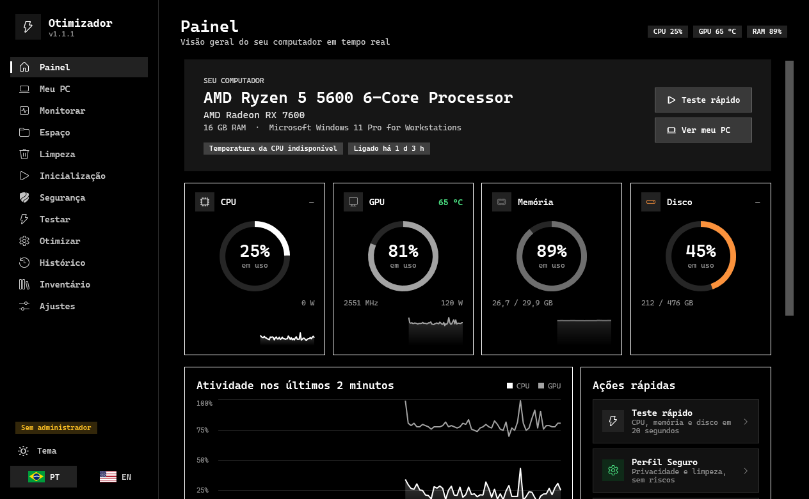
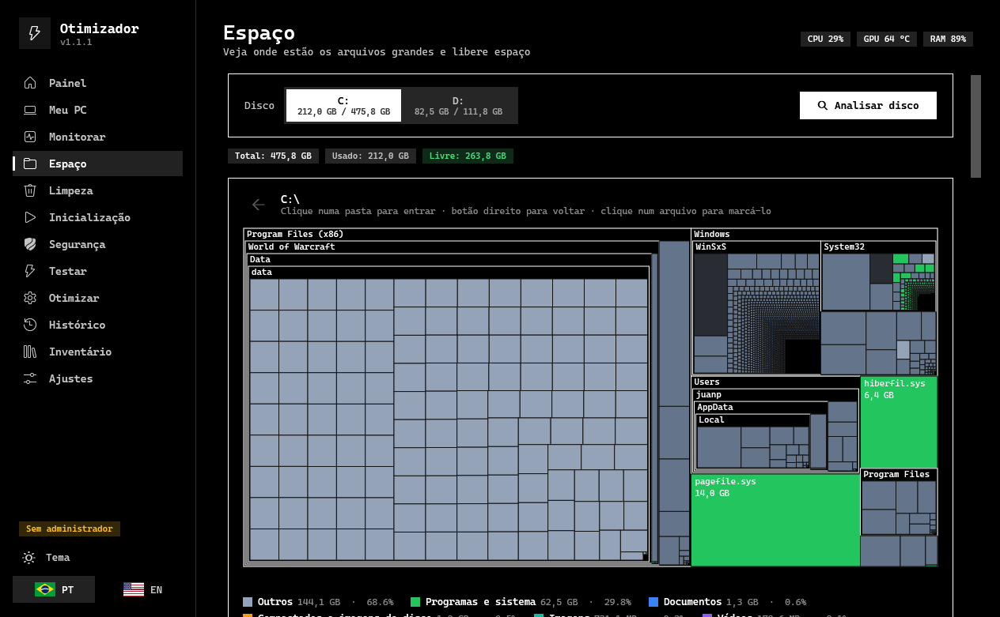
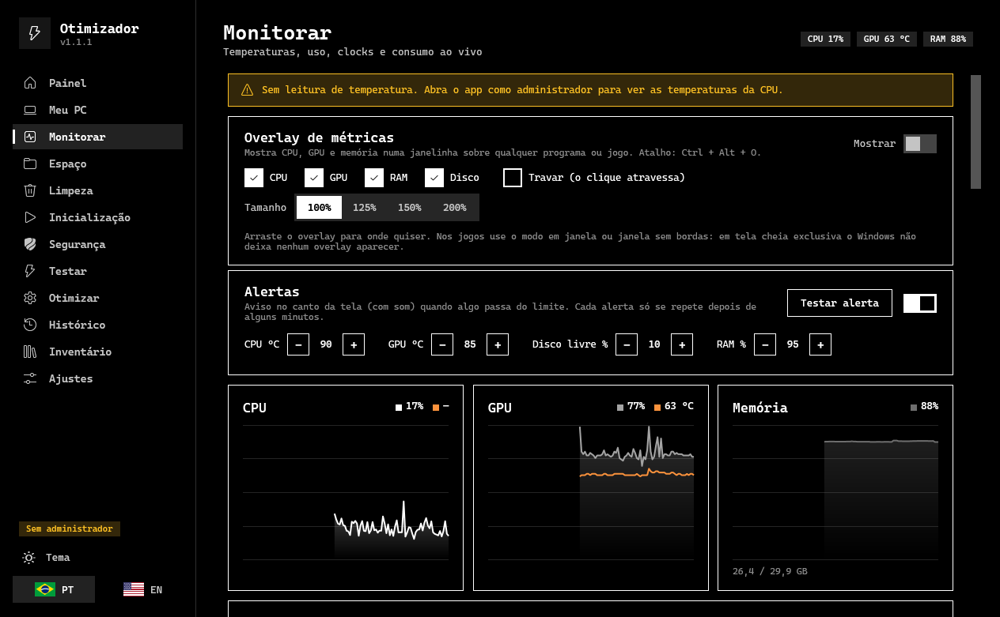
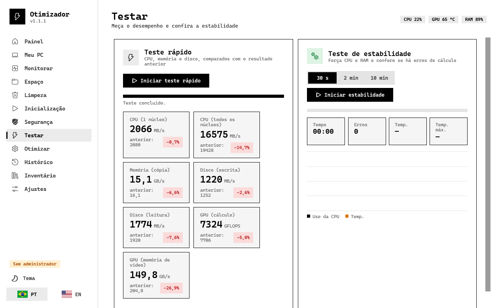
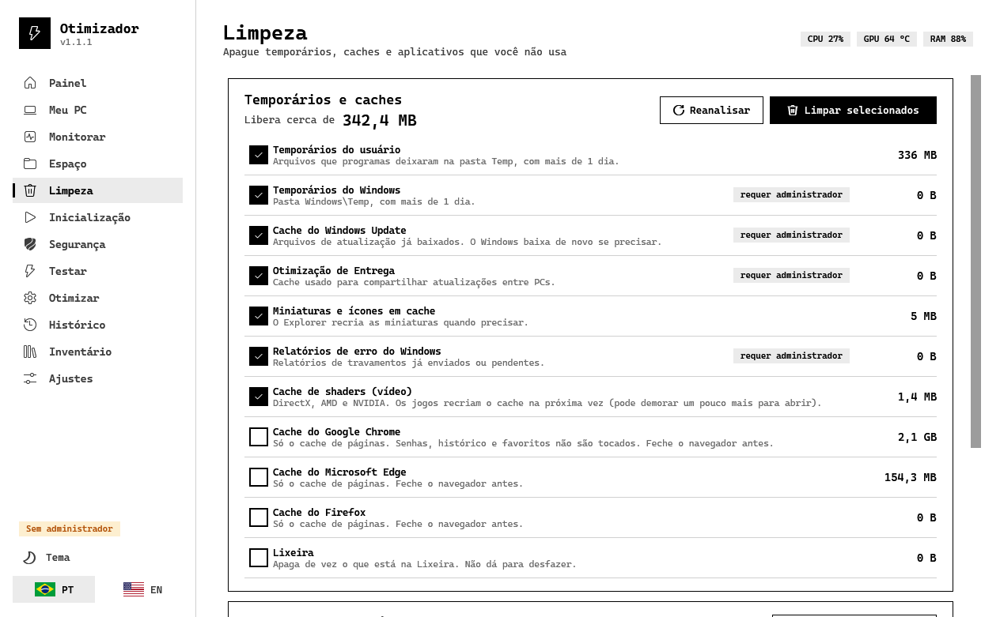

# Otimizador

**Diagnóstico, monitoramento, limpeza e otimização do Windows num programa só.** Reúne o que normalmente exige vários softwares (CPU-Z, AIDA64, OCCT, HWiNFO, WinDirStat, CrystalDiskInfo, um otimizador...) numa interface única, em português e inglês, com tema claro e escuro.

> *English:* an all-in-one Windows 10/11 toolkit: hardware info, live monitoring with overlay, benchmarks and stability test (CPU, memory, disk, GPU), disk-space treemap with duplicate finder, cleanup, startup manager, security check, reversible tweaks, history/reports and self-update from GitHub Releases. The UI is available in Portuguese and English.



| | |
|---|---|
|  |  |
|  |  |

## O que ele faz

| Área | Recursos |
|---|---|
| **Painel** | Medidores ao vivo de CPU, GPU, memória e disco; atividade dos últimos 2 min; maiores consumidores de memória; ações rápidas |
| **Meu PC** | Inventário completo, **saúde dos discos** (desgaste, temperatura, horas ligado, erros) e **da bateria** |
| **Monitorar** | Gráficos, uso por núcleo, todos os sensores, gravação em CSV, **rede** (velocidade, ping, programas com conexões), **overlay** e **alertas** |
| **Espaço** | Mapa colorido do disco (treemap) para achar o que ocupa espaço, **arquivos duplicados**, e exclusão segura para a Lixeira |
| **Limpeza** | Temporários, caches (Windows, shaders, navegadores), Lixeira e remoção de apps pré-instalados |
| **Inicialização** | Liga/desliga o que abre junto com o Windows (sem desinstalar nada) |
| **Segurança** | Antivírus, firewall, BitLocker, Secure Boot, TPM, UAC e atualizações do Windows, com pontuação |
| **Testar** | Benchmarks de CPU, memória, disco e **GPU (Direct3D 11)**, comparados com o resultado anterior; teste de estabilidade com detecção de erros. Dá para **escolher as peças** (processador, RAM, placa de vídeo, disco), sozinhas ou combinadas, nos dois testes |
| **Otimizar** | Perfis e 17 ajustes **reversíveis** (privacidade, jogos, serviços, hibernação, DNS...) com ponto de restauração |
| **Histórico** | Temperatura e uso de 1 h / 24 h / 7 dias e **relatório em HTML** (imprimível em PDF) |
| **Inventário** | Para empresas: cada PC publica um resumo numa pasta compartilhada e você vê todos numa tela |
| **Ajustes** | Atualização pelo GitHub, ícone na bandeja, abrir com o Windows, **modo jogo**, limpeza semanal |
| **Sobre** | Autor, links do projeto, licença e créditos |

Atalho global: **Ctrl + Alt + O** liga/desliga o overlay de métricas.

### Segurança e honestidade
- **Nada é apagado sem confirmação**, e arquivos vão para a **Lixeira** (dá para restaurar). Windows, programas instalados e a raiz do disco são protegidos.
- Todo ajuste de otimização guarda o valor original e tem **Desfazer**.
- **Sem telemetria**: o programa não envia nada para fora. A única conexão é a consulta opcional à API pública do GitHub para ver se há versão nova.
- Modo jogo, limpeza agendada e inventário vêm **desligados por padrão**.

## Instalação

1. Baixe na página de [Releases](../../releases/latest):
   - **`Otimizador-Setup-x.y.z.exe`**: instalador (atalho no Menu Iniciar, desinstalador, atualiza sozinho).
   - **`Otimizador-Portatil-x.y.z.zip`**: extraia onde quiser e abra `Otimizador.exe` (os dados ficam na pasta `Dados`, ao lado do programa).
2. O programa **pede permissão de administrador** ao abrir: ela é necessária para temperaturas, ajustes de sistema e saúde dos discos.
3. Para a **temperatura de CPUs AMD Ryzen** o programa usa o driver [PawnIO](https://github.com/namazso/PawnIO) (GPL-2.0, de namazso), que **já vem dentro do pacote** (pasta `Drivers`, instalador oficial sem alteração, conferido por SHA-256 antes de rodar). No instalador há a opção "Instalar o driver PawnIO" (marcada por padrão); na versão portátil, ou se você pular a opção, o programa oferece instalar na primeira vez que a temperatura não aparecer, e há o botão "Instalar driver agora" na aba Monitorar. Nada para baixar à parte. Para remover: Configurações do Windows → Aplicativos → PawnIO.

> **Aviso do Windows:** o programa **não é assinado digitalmente** (certificado de código é pago). Na primeira execução o SmartScreen pode mostrar "Windows protegeu o computador": clique em *Mais informações → Executar assim mesmo*. Em PCs com o **Smart App Control** ligado o Windows pode bloquear o arquivo; nesse caso é preciso desativar o Smart App Control (Segurança do Windows → Controle de aplicativos e navegador). O código é aberto: você pode revisar tudo e compilar por conta própria.

Requisitos: Windows 10 22H2 ou 11, 64 bits. O .NET já vem dentro do pacote.

## Atualizações automáticas

O programa procura uma versão nova nas **Releases** deste repositório (no máximo uma vez por dia, e dá para desligar em *Ajustes*). Ao encontrar, mostra "Atualização x.y.z" no menu; um clique baixa o instalador, **confere o SHA-256 publicado na mesma Release** e atualiza, preservando as configurações.

- O repositório de onde vêm as atualizações é o oficial (`Juan3403/Otimizador`); quem faz um fork pode trocar em *Ajustes* ou pelo arquivo `update-repo.txt` que o script de release grava no pacote.
- Só são aceitos downloads por **HTTPS** de domínios do GitHub, e só se o arquivo bater com o `SHA256SUMS.txt` da Release.

## Publicar uma versão nova (para o mantenedor)

**Pelo GitHub (recomendado):** crie a tag e envie; o workflow `.github/workflows/release.yml` compila, gera o instalador, o zip e o `SHA256SUMS.txt` e publica a Release (já gravando o repositório certo dentro do pacote).

```
git tag v1.2.0
git push origin v1.2.0
```

**Manual:**

```powershell
.\tools\build-release.ps1 -Version 1.2.0
gh release create v1.2.0 dist\* --title "Otimizador 1.2.0" --notes "O que mudou"
```

Os PCs que já têm o programa instalado recebem a atualização na próxima verificação.

## Compilar do código-fonte

Requisitos: .NET 8 SDK e, para o instalador, Inno Setup 6.

```powershell
dotnet build
dotnet run
```

Testes automatizados (xUnit, na pasta `Tests/`; também rodam antes de cada Release):

```
dotnet test Tests/Otimizador.Tests.csproj
```

Verificação sem interface (retorna 0 se tudo passou):

```
Otimizador.exe --selftest relatorio.txt [segundos_de_estabilidade]
Otimizador.exe --stresstest saida.txt   # estabilidade por peça (CPU, RAM, GPU, disco), 2 s cada
Otimizador.exe --snapshots pasta        # gera imagens de todas as telas nos dois temas
```

Estrutura (tudo em um único projeto): `Hardware/` (sensores e inventário), `Bench/`, `Disk/` (mapa e duplicados), `Cleanup/`, `Boot/` (inicialização), `Tweaks/`, `Security/`, `Network/`, `Inventory/`, `Updates/`, `GameMode/`, `Overlay/`, `Alerts/`, `Tray/`, `ViewModels/`, `Views/`, `Themes/`, `Localization/`, `installer/`, `tools/`.

## Autor

Feito por **Juan** ([@Juan3403](https://github.com/Juan3403)). Sugestões e problemas: abra uma [issue](../../issues). Se gostou, deixe uma estrela no repositório!

## Créditos e licença

Licença **MIT** (veja `LICENSE`). Usa [LibreHardwareMonitor](https://github.com/LibreHardwareMonitor/LibreHardwareMonitor) (MPL-2.0) para os sensores, [Vortice.Windows](https://github.com/amerkoleci/Vortice.Windows) para o teste de GPU, [H.NotifyIcon](https://github.com/HavenDV/H.NotifyIcon) para a bandeja e [CommunityToolkit.Mvvm](https://github.com/CommunityToolkit/dotnet).

